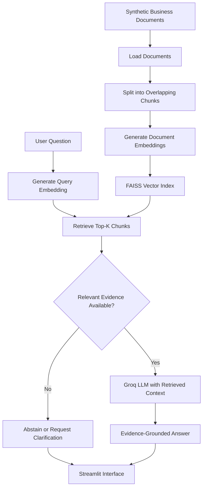

# SmartShop BD — Business Knowledge Assistant

**A source-aware Retrieval-Augmented Generation (RAG) prototype for the NineCube Digital technical assessment.**

**Repository:** https://github.com/jobayertalha/Assesment_ninecube

> **Assessment data notice:** SmartShop BD is a fictional Bangladeshi retailer. All sample products, prices, contact details, and business policies are synthetic examples created for this assessment.

## 1. The Story Behind the Project

### The Problem

Businesses maintain information about products, prices, delivery services, warranties, return policies, and customer support in documents. Finding the correct information can take time, especially when users ask questions in natural language.

A general-purpose AI chatbot can make this process easier, but it may also generate plausible answers that are not supported by the business's actual information. This is particularly problematic when answering questions about prices, product specifications, or return conditions.

The challenge is therefore to build an assistant that can find relevant information, use that evidence to answer questions, and recognize when the available information is insufficient.

### The Objective

SmartShop BD was designed to explore how Retrieval-Augmented Generation (RAG) can address this problem.

The goal was to build a working prototype that:

- Answers business-related questions using a defined knowledge base.
- Retrieves relevant document passages before generating an answer.
- Grounds generated responses in the retrieved evidence.
- Avoids guessing when the knowledge base does not contain the requested information.
- Provides a simple interface for interacting with the assistant.
- Evaluates retrieval behavior, answer quality indicators, abstention behavior, and response latency.

**The objective is not simply to build a chatbot. It is to build a testable question-answering system that connects its responses to available business information.**

## 2. Task 1 — Solution Design

### Why RAG?

Retrieval-Augmented Generation combines two processes:

1. **Retrieval:** Find relevant information from a supplied collection of documents.
2. **Generation:** Use that information as context for a language model to formulate an answer.

Instead of relying only on the language model's pretrained knowledge, SmartShop BD retrieves passages from its own knowledge base before generating a response.

This design makes the answers more specific to the business and allows the retrieved evidence to be inspected.

### Architecture



### Technology Choices

| Technology | Role in the solution |
|---|---|
| Python | Implements document processing, retrieval, generation, and evaluation |
| Streamlit | Provides the interactive user interface |
| Sentence Transformers | Converts document passages and questions into numerical embeddings |
| FAISS | Performs vector similarity search |
| Groq API | Generates natural-language answers using retrieved context |
| pytest | Runs basic automated tests |
| CSV and JSON | Store evaluation results and aggregate metrics |

The system uses the `sentence-transformers/all-MiniLM-L6-v2` embedding model by default. Embeddings are normalized, and FAISS `IndexFlatIP` is used for inner-product search, which corresponds to cosine-similarity search for normalized vectors.

The implementation uses a local FAISS index rather than a separate hosted vector database. Streamlit handles the user interface, so a separate frontend and API server are not required for this prototype.

### Key Design Decisions

**Grounding answers in evidence:** Retrieved passages are included in the generation prompt, with instructions to answer from the available context.

**Handling missing information:** A configurable retrieval threshold supports fallback behavior when the retrieved evidence is insufficient.

**Preserving traceability:** Source metadata is retained so retrieved documents and passages can be inspected.

**Handling ambiguity:** The system includes basic ambiguity handling and can request clarification rather than make an unsupported assumption.

**Keeping the solution lightweight:** The prototype uses a small Markdown knowledge base and avoids unnecessary infrastructure.

## 3. Task 2 — Building the Working Prototype

With the design established, the next step was to connect the individual components into a functioning application.

### Step 1: Prepare the Knowledge Base

The project uses Markdown documents containing synthetic SmartShop BD business information, such as product details, delivery charges, warranty periods, and return policies.

The documents are loaded and divided into overlapping text chunks. Chunking allows the retriever to find relevant passages without requiring an entire document to be passed to the language model for every question.

### Step 2: Create the Search Index

Sentence Transformers converts each chunk into an embedding. These vectors are normalized and stored in a FAISS index.

When a question arrives, the system creates its embedding and searches for the most similar document chunks.

### Step 3: Retrieve Relevant Evidence

The retriever returns up to four chunks by default. A configurable minimum relevance score determines whether the retrieved evidence is sufficiently relevant to proceed.

The default settings are starting points and should be validated against representative questions rather than treated as universally optimal.

### Step 4: Generate the Answer

When relevant evidence is available, the application passes the question and retrieved context to the Groq language model. The prompt instructs the model to use the supplied evidence rather than invent missing business facts.

When the evidence is insufficient, the system can abstain instead of generating an unsupported answer.

### Step 5: Display the Result

The Streamlit interface allows users to interact with the assistant. The project includes Home, AI Assistant, Evaluation, and Contact pages.

### Example Interactions

The following examples illustrate the intended behavior using the synthetic knowledge base.

| Question | Expected behavior |
|---|---|
| How much is delivery within Dhaka? | Retrieve the delivery policy and answer BDT 60 |
| What is the warranty period for Nova A1? | Retrieve the product information and answer 12 months |
| Does EchoBuds Lite support wireless charging? | Abstain because the specification is not documented |
| Can I return an opened item? | Preserve the policy's eligibility conditions; ask for clarification or refer to support if eligibility cannot be established |

For example, the return policy states that a request must be made within seven days and that the item must be unopened or defective. Merely retrieving the seven-day period is not enough if the answer omits the eligibility condition.

These examples use fictional business information and are intended to illustrate the system's behavior, not real commercial policies.

## 4. Task 3 — Testing and Evaluation

Building a working application is only part of the task. The next question is whether the system retrieves useful information, handles missing information appropriately, and responds within a reasonable time.

### Evaluation Method

The project includes an evaluation question set and a repeatable evaluation script. The recorded test set contains 12 questions:

- 8 answerable questions.
- 3 unanswerable questions.
- 1 ambiguous question.

The evaluation script runs questions through the retrieval and generation pipeline and records per-question results.

The evaluation considers:

| Metric | What it measures |
|---|---|
| Retrieval hit rate at K | Whether the expected source file is among the retrieved sources |
| Source-level Precision@k | How many retrieved source references match the expected sources |
| Reference-fact coverage | A text-based comparison between generated answers and reference facts |
| Abstention behavior | Whether the system abstains for questions labelled unanswerable |
| Response latency | Time taken to process each question |
| Manual relevance and grounding | Reviewer assessment of answer relevance and support from retrieved evidence |

### Recorded Results

The following results come from the recorded 12-question evaluation run.

| Metric | Result |
|---|---:|
| Total questions | 12 |
| Retrieval hit rate at K | 100% |
| Mean source-level Precision@k | 43.75% |
| Mean reference-fact coverage | 93.75% |
| Automated outcome rate | 100% |
| Unanswerable-question abstention | 3/3 |
| Ambiguous-question handling | 1/1 |
| Mean response latency | 1.32 seconds |
| Median response latency | 0.68 seconds |
| Recorded P95 latency | 6.67 seconds |

### What Do These Results Tell Us?

The recorded run shows that the expected source files were retrieved for all test questions and that the system handled the three labelled unanswerable questions by abstaining.

However, the results should be interpreted carefully.

- A 100% retrieval hit rate does not mean every retrieved chunk is relevant.
- The 43.75% source-level Precision@k indicates that retrieval can return additional sources that do not match the expected source set.
- Reference-fact coverage is a simple text-based indicator. It may miss valid paraphrases and cannot detect every unsupported claim.
- The automated outcome rate is not the same as semantic accuracy or factual correctness.
- A 12-question test set is too small to establish reliable production performance.
- The recorded latency is descriptive of this run and may change with network conditions, API availability, and model loading.

Manual inspection of generated answers and retrieved passages remains necessary.

### Failure Cases and Limitations Found

**1. Missing policy conditions**

An answer may correctly mention the seven-day return window but omit that the item must be unopened or defective. This shows that retrieving a relevant document does not guarantee that the final answer preserves every important condition.

**2. Missing product specifications**

Questions about EchoBuds Lite wireless charging or battery capacity cannot be answered reliably when those specifications are absent from the knowledge base. Abstaining is preferable to inventing product details.

**3. Retrieval ranking**

Finding the expected source file does not guarantee that the most useful passage is ranked first. Additional retrieval-quality testing is needed.

**4. Limited test coverage**

The evaluation set does not cover every possible question, phrasing, document structure, or real-world interaction.

### What Should Improve Next?

The evaluation suggests several practical improvements:

1. Expand the test set with paraphrased questions, policy edge cases, and missing-information scenarios.
2. Manually review generated answers against their retrieved evidence and complete the evaluation review fields.
3. Investigate retrieval precision and ranking before tuning the relevance threshold.
4. Test whether the generation prompt consistently preserves policy conditions.
5. Measure latency over repeated runs, including cold starts.
6. Consider hybrid retrieval, reranking, monitoring, and stronger access controls before production use.

These are future improvements, not claims that the current prototype already implements them.

### Reproduce the Evaluation

Configure the Groq API key and build the index before running the evaluation:

```bash
python ingest.py
python scripts/evaluate_rag.py
```

The script generates:

- `results/evaluation_results.csv` — per-question results, retrieved sources, generated answers, timing, and review fields.
- `results/evaluation_summary.json` — aggregate measurements from the run.

The CSV includes fields intended for manual review, including `answer_relevance_manual_0_1`, `grounding_manual_0_1`, and reviewer notes. These fields should only be marked complete after the answers have actually been reviewed.

See [`docs/evaluation_report.md`](docs/evaluation_report.md) for the evaluation methodology, metric interpretation, and review rubric.

## 5. Task 4 — Engineering and Documentation

The prototype is organized into separate modules so that document ingestion, retrieval, answer generation, interface code, and evaluation can be maintained independently.

### Project Structure

```text
.
├── app.py
├── agent.py
├── rag.py
├── ingest.py
├── requirements.txt
├── .env.example
├── .devcontainer/
│   └── devcontainer.json
├── data/
│   ├── knowledge_base/
│   └── evaluation_questions.jsonl
├── scripts/
│   └── evaluate_rag.py
├── tests/
│   └── test_rag.py
├── results/
│   ├── evaluation_results.csv
│   └── evaluation_summary.json
└── docs/
    ├── evaluation_report.md
    ├── demo_script.md
    └── technical_presentation_outline.md
```

The FAISS index is generated locally and excluded from Git. The application includes index-initialization logic intended to build the index when it is missing.

Generated evaluation files should be committed if they are part of the final evidence submitted for the assessment.

### Run the Project Locally

#### 1. Clone the repository

```bash
git clone https://github.com/jobayertalha/Assesment_ninecube.git
cd Assesment_ninecube
```

You can also open the repository in GitHub Codespaces.

#### 2. Install dependencies

Use Python 3.11 and install the dependencies:

```bash
pip install -r requirements.txt
```

Using a virtual environment is recommended.

#### 3. Configure the API key

Copy the example environment file:

```bash
cp .env.example .env
```

Add your valid Groq API key to `.env`.

Never commit `.env`, hard-code API keys in source files, or expose credentials in screenshots or recordings.

#### 4. Build the knowledge-base index

```bash
python ingest.py
```

The first run downloads the embedding model and may take a few minutes. The generated index is stored in `faiss_index/`, which is excluded from Git.

#### 5. Run the application

```bash
streamlit run app.py
```

Open the local URL shown in the terminal. In GitHub Codespaces, open the forwarded Streamlit port, usually `8501`.

### Run Unit Tests

```bash
pytest -q
```

The basic unit tests are intended to run without a Groq API key or an embedding-model download.

### Configuration

| Environment variable | Default | Purpose |
|---|---|---|
| `GROQ_API_KEY` | None | API key required for answer generation |
| `GROQ_MODEL` | `llama-3.3-70b-versatile` | Groq chat model; availability should be verified |
| `EMBEDDING_MODEL` | `sentence-transformers/all-MiniLM-L6-v2` | Embedding model |
| `MIN_RELEVANCE_SCORE` | `0.38` | Initial relevance threshold |
| `TOP_K` | `4` | Maximum number of retrieved chunks |

The threshold is an initial configuration and should be calibrated against representative questions. If the embedding model changes, rebuild the index.

## 6. Limitations, Privacy, and Future Scope

SmartShop BD is a proof of concept built around a small synthetic Markdown knowledge base. It demonstrates the core RAG workflow but does not establish performance at production scale.

### Current Limitations

- **Small corpus:** The results do not establish performance on a large or real business knowledge base.
- **Threshold sensitivity:** The retrieval threshold requires validation against representative queries.
- **Automated evaluation:** Text-based metrics cannot reliably establish semantic accuracy or factual grounding.
- **External dependency:** Generation quality and latency depend on the Groq API, network conditions, and model behavior.
- **Security limitations:** The prototype does not provide production authentication, role-based access control, comprehensive audit logging, or data-retention controls.
- **Privacy considerations:** User questions and retrieved context are sent to the external LLM provider for answer generation.

### Future Scope

A production-oriented version could introduce a larger knowledge base, improved retrieval ranking, reranking, stronger factual-grounding evaluation, structured source citations, monitoring, access controls, and security/privacy reviews.

Confidential customer records should not be added without authorization and an appropriate data-handling process.

## 7. Credits and External Resources

The application pattern is adapted from the author's own CareerVector repository, with the use case changed from CV/job matching to business-document question answering. The SmartShop BD sample business information is synthetic.

- [Streamlit documentation](https://docs.streamlit.io/)
- [Sentence Transformers documentation](https://www.sbert.net/)
- [FAISS repository](https://github.com/facebookresearch/faiss)
- [Groq API documentation](https://console.groq.com/docs)

## 8. Assessment Deliverables

The repository is organized to support all four tasks of the NineCube Digital assessment.

| Task | Relevant files and evidence |
|---|---|
| **Task 1 — Solution Design** | Architecture diagram and solution-design sections in this README; `docs/technical_presentation_outline.md` |
| **Task 2 — Working Prototype** | `app.py`, `rag.py`, `agent.py`, `ingest.py`, and `data/knowledge_base/` |
| **Task 3 — Evaluation** | `data/evaluation_questions.jsonl`, `scripts/evaluate_rag.py`, `docs/evaluation_report.md`, and the files in `results/` |
| **Task 4 — Engineering and Documentation** | Source code, `requirements.txt`, `.env.example`, `tests/`, and this README |

### Final Submission Checklist

1. **Source code and README:** Submit the GitHub repository.
2. **Technical presentation:** Prepare approximately 5–8 slides covering the problem, architecture, implementation, evaluation, limitations, and future improvements.
3. **Screen recording or walkthrough:** Demonstrate the prototype, a successful answer, a question with missing information, and the system's fallback behavior.
4. **Evaluation evidence:** Include representative test questions, outputs, recorded metrics, and findings.

The final outcome is a working and testable RAG prototype with a documented design, reproducible evaluation process, and transparent discussion of its limitations.

The central lesson from this project is that a useful business assistant must do more than generate fluent answers: it must retrieve relevant evidence, preserve important details, and recognize when it does not know enough to answer confidently.
