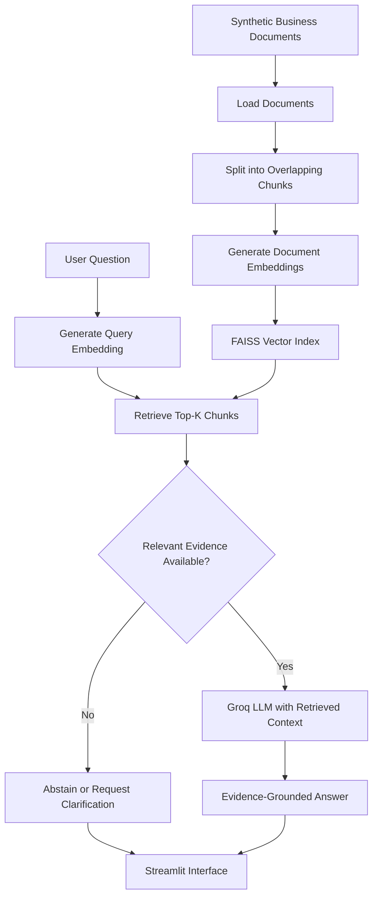

# SmartShop BD — Business Knowledge Assistant

A Retrieval-Augmented Generation (RAG) prototype built for the NineCube Digital technical assessment. It answers business questions using retrieved knowledge-base documents and avoids guessing when information is unavailable.

**Repository:** https://github.com/jobayertalha/Assesment_ninecube

> **Note:** SmartShop BD and all business information are synthetic examples created for this assessment.

## 1. Problem & Objective

Business information such as product details, delivery charges, warranties, and return policies can be difficult to retrieve manually. General-purpose AI assistants may also generate unsupported answers.

**Objective:** Build a lightweight assistant that retrieves relevant business information, generates evidence-grounded answers, and abstains when the available information is insufficient.

## 2. Solution Architecture

### Architecture




**How it works:** Documents are split into overlapping chunks and embedded using `all-MiniLM-L6-v2`. FAISS retrieves relevant passages, which are passed to the Groq language model as context. A relevance threshold supports fallback behavior when sufficient evidence is unavailable.

## 3. Technology Stack

| Technology | Purpose |
|---|---|
| Python | Core application and evaluation |
| Streamlit | User interface |
| Sentence Transformers | Text embeddings |
| FAISS | Similarity search |
| Groq API | Answer generation |
| pytest | Unit testing |

## 4. Implementation & Testing

The prototype includes:

- Markdown knowledge-base ingestion and chunking.
- Embedding generation and FAISS indexing.
- Evidence-grounded answer generation and basic abstention handling.
- Streamlit interface.
- Evaluation script, sample questions, result files, and unit tests.

### Recorded Evaluation

Results from a 12-question test set:

| Metric | Result |
|---|---:|
| Retrieval hit rate@K | 100% |
| Mean source-level Precision@k | 43.75% |
| Reference-fact coverage | 93.75% |
| Unanswerable questions correctly abstained | 3/3 |
| Mean response latency | 1.32 s |

These are small-sample results, not proof of production-level accuracy. Reference-fact coverage is text-based, and generated answers still require manual grounding review.

**Known limitations:** Small synthetic knowledge base, imperfect retrieval precision, possible omission of important policy conditions, and dependence on an external LLM API.

See [`docs/evaluation_report.md`](docs/evaluation_report.md) for the evaluation methodology, detailed results, failure cases, and improvement plan.

## 5. Run Locally

**Requirements:** Python 3.11 and a Groq API key.

```bash
git clone https://github.com/jobayertalha/Assesment_ninecube.git
cd Assesment_ninecube
pip install -r requirements.txt
```

Configure `GROQ_API_KEY` in your `.env` file, then run:

```bash
python ingest.py
streamlit run app.py
```

Run the tests:

```bash
pytest -q
```

Run the evaluation after configuring the API key and building the index:

```bash
python scripts/evaluate_rag.py
```

Never commit API keys or confidential information.

## 6. Project Structure

```text
app.py                         # Streamlit interface
rag.py                         # Retrieval and vector indexing
agent.py                       # Answer-generation logic
ingest.py                      # Knowledge-base ingestion
data/knowledge_base/            # Synthetic business documents
data/evaluation_questions.jsonl # Evaluation questions
scripts/evaluate_rag.py        # Evaluation runner
tests/test_rag.py              # Unit tests
results/                       # Evaluation outputs
docs/evaluation_report.md      # Detailed evaluation report
docs/demo_script.md            # Demonstration guide
docs/technical_presentation_outline.md
```

## 7. Assessment Deliverables

| Task | Evidence |
|---|---|
| Task 1 — Solution Design | Architecture and design in this README |
| Task 2 — Working Prototype | Application, retrieval pipeline, and knowledge base |
| Task 3 — Evaluation | Evaluation script, results, and evaluation report |
| Task 4 — Engineering & Documentation | Source code, setup instructions, dependencies, and tests |

**Submission:** GitHub repository, 5–8-slide technical presentation, screen recording, and evaluation evidence.

## 8. Limitations & Future Work

Future improvements include better retrieval ranking, broader evaluation coverage, stronger factual-grounding checks, latency optimization, and production-grade security controls.

The current prototype uses synthetic data and does not implement production authentication or comprehensive data-retention controls.

## Credits

The application pattern is adapted from the author's CareerVector repository. Business data is synthetic.

- [Streamlit](https://docs.streamlit.io/)
- [Sentence Transformers](https://www.sbert.net/)
- [FAISS](https://github.com/facebookresearch/faiss)
- [Groq API](https://console.groq.com/docs)
