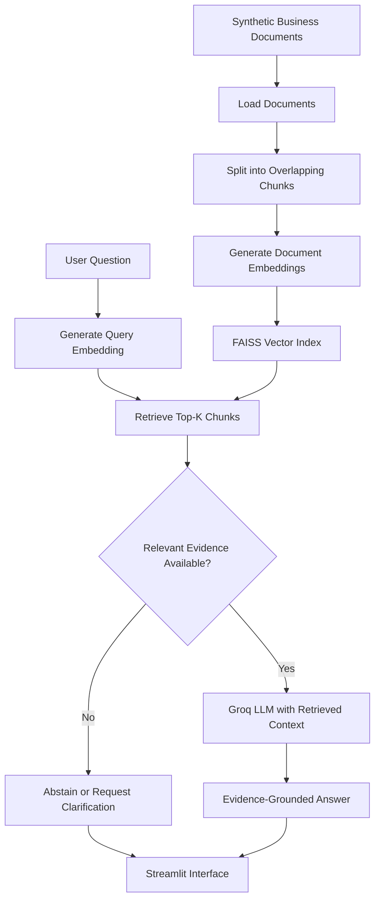

# SmartShop BD — Business Knowledge Assistant

A Retrieval-Augmented Generation (RAG) prototype developed for the NineCube Digital AI/ML Engineer technical assessment. It retrieves business information from a knowledge base and uses an LLM to generate evidence-grounded answers, with fallback behavior when information is insufficient.

**Repository:** https://github.com/jobayertalha/Assesment_ninecube

> **Note:** SmartShop BD and all business information are synthetic examples created for this assessment.

## 1. The Problem & Objective

Businesses store product details, delivery charges, warranty information, and return policies across documents. Finding accurate answers manually takes time, while general-purpose AI assistants may generate unsupported information.

**Objective:** Build a lightweight assistant that retrieves relevant business information, generates answers grounded in retrieved evidence, and abstains when the available information is insufficient.

## 2. Solution Architecture

The solution follows a RAG pipeline: prepare the knowledge base, retrieve relevant passages for each question, and generate an answer using that evidence.



**How it works:** Markdown documents are divided into overlapping chunks and embedded using `all-MiniLM-L6-v2`. FAISS retrieves the most similar passages. When the retrieved evidence meets the configured relevance threshold, the passages are sent to the Groq language model as context. Otherwise, the application can fall back rather than guess.

## 3. Technology Stack

| Technology | Purpose |
|---|---|
| Python | Application, ingestion, retrieval, and evaluation |
| Streamlit | User interface |
| Sentence Transformers | Local semantic embeddings |
| FAISS | Vector similarity search |
| Groq API | LLM-based answer generation |
| pytest | Automated unit tests |

Normalized embeddings and FAISS `IndexFlatIP` are used for cosine-similarity retrieval. A separate hosted vector database or frontend server is not required.

## 4. Implementation & Evaluation

The prototype includes:

- Markdown knowledge-base ingestion and overlapping chunking.
- Embedding generation and FAISS indexing.
- Top-K retrieval with a configurable relevance threshold.
- Evidence-grounded answer generation and basic abstention handling.
- Streamlit interface, evaluation script, sample questions, and unit tests.

### Recorded evaluation

Results from the recorded 12-question test set:

| Metric | Result |
|---|---:|
| Retrieval hit rate@K | 100% |
| Mean source-level Precision@k | 43.75% |
| Reference-fact coverage | 93.75% |
| Unanswerable questions correctly abstained | 3/3 |
| Mean response latency | 1.32 s |

These results are descriptive of a small test set, not proof of production-level accuracy. Retrieval hit rate measures whether expected source files were found; reference-fact coverage is text-based and does not establish semantic correctness. Generated answers still require manual grounding review.

### What testing revealed

- **Retrieval precision:** Relevant source files were found, but additional retrieved sources reduced source-level precision.
- **Missing information:** The assistant should abstain when product specifications are absent from the knowledge base.
- **Policy completeness:** An answer can retrieve the correct policy but still omit an important condition.
- **Evaluation limits:** A small test set and automated text matching cannot establish general factual accuracy.

**Next improvements:** Expand test coverage, manually review answer relevance and grounding, improve retrieval ranking, calibrate the relevance threshold, and evaluate latency over repeated runs.

See [`docs/evaluation_report.md`](docs/evaluation_report.md) for the methodology, detailed results, failure cases, and improvement plan.

## 5. Run Locally

### Requirements

- Python 3.11
- A valid Groq API key
- Internet access for dependency installation, initial model download, and API calls

### 1. Clone the repository

```bash
git clone https://github.com/jobayertalha/Assesment_ninecube.git
cd Assesment_ninecube
```

### 2. Install dependencies

```bash
python -m venv .venv
```

Activate the environment:

```bash
# Windows
.venv\Scripts\activate

# macOS / Linux
source .venv/bin/activate
```

Install the project dependencies:

```bash
pip install -r requirements.txt
```

### 3. Configure the API key

Copy `.env.example` to `.env` and add your key:

```env
GROQ_API_KEY=your_groq_api_key
```

Never commit `.env` or expose API keys in source code, screenshots, or recordings.

### 4. Build the knowledge-base index

```bash
python ingest.py
```

This processes the Markdown documents and builds the local FAISS index. The initial run may download the embedding model.

### 5. Run the application

```bash
streamlit run app.py
```

Open the local URL shown in the terminal.

### 6. Run tests

```bash
pytest -q
```

### 7. Run the evaluation

After configuring the API key and building the index:

```bash
python scripts/evaluate_rag.py
```

The evaluation produces:

- `results/evaluation_results.csv` — per-question answers, retrieved sources, and timing.
- `results/evaluation_summary.json` — aggregate evaluation metrics.

## 6. Project Structure

```text
.
├── app.py
├── agent.py
├── rag.py
├── ingest.py
├── requirements.txt
├── .env.example
├── data/
│   ├── knowledge_base/
│   └── evaluation_questions.jsonl
├── scripts/
│   └── evaluate_rag.py
├── tests/
│   └── test_rag.py
├── results/
│   ├── evaluation_results.csv
│   └── evaluation_summary.json
└── docs/
    ├── evaluation_report.md
    ├── demo_script.md
    └── technical_presentation_outline.md
```

The FAISS index is generated locally and excluded from Git. The application includes index-initialization logic intended to build the index when it is missing.

## 7. Dependencies, Error Handling & Security

**External services and models**

- **Groq API:** Generates answers using the retrieved context. Requires `GROQ_API_KEY`.
- **Sentence Transformers:** Creates local embeddings using `sentence-transformers/all-MiniLM-L6-v2`. The model must be downloaded before first use.
- **FAISS:** Stores and searches the local vector index.
- **Streamlit:** Runs the interface.

Install dependencies through `requirements.txt`. Model and package versions are controlled by the configured dependencies.

**Error handling and tests**

The system uses a relevance threshold to support abstention when evidence is insufficient and includes basic ambiguity handling. The project provides pytest tests and a repeatable evaluation script. Run `pytest -q` to execute the available tests.

**Privacy and security**

The included business information is synthetic. User questions and retrieved context are sent to the external LLM provider for generation. A real deployment should use appropriate access controls, secure secret management, data minimization, logging and retention policies, and a privacy review. Confidential information should not be submitted without authorization.

## 8. Limitations & Future Work

The prototype uses a small synthetic knowledge base and does not establish performance at production scale. Retrieval ranking, threshold calibration, and semantic evaluation require further work. The application also lacks production-grade authentication and comprehensive data-retention controls.

Future improvements include broader evaluation, better retrieval ranking, stronger factual-grounding checks, latency optimization, and production security controls.

## Credits

The application pattern is adapted from the author's CareerVector repository, with the use case changed to business-document question answering. The business data is synthetic.

- [Streamlit documentation](https://docs.streamlit.io/)
- [Sentence Transformers documentation](https://www.sbert.net/)
- [FAISS repository](https://github.com/facebookresearch/faiss)
- [Groq API documentation](https://console.groq.com/docs)

## 9. Assessment Deliverables

| Assessment task | Evidence in the repository |
|---|---|
| Task 1 — Solution Design | Architecture and design in this README |
| Task 2 — Working Prototype | Application, retrieval pipeline, and knowledge base |
| Task 3 — Evaluation | Evaluation script, results, and evaluation report |
| Task 4 — Engineering & Documentation | Source code, setup instructions, dependencies, and tests |

**Final submission:** GitHub repository, 5–8-slide technical presentation, screen recording, and evaluation evidence.
